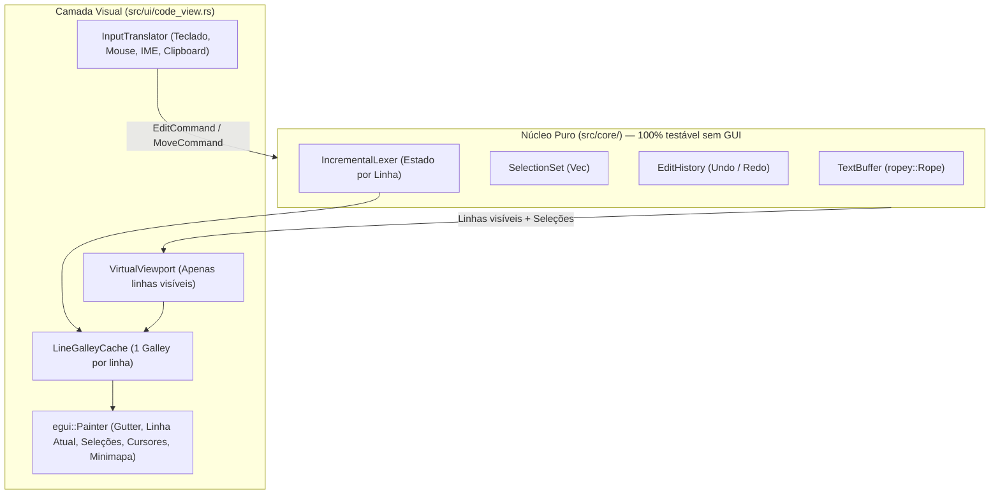

# Arquitetura do Widget de Editor Próprio (`egui` + `ropey`)

Este documento detalha o projeto técnico da **Opção A**: substituir o `egui::TextEdit` padrão por um motor de edição próprio em Rust (`src/core/`) acoplado a um widget customizado e virtualizado no `egui` (`src/ui/code_view.rs`), utilizando a estrutura de dados **Rope** (`ropey`).

O objetivo é habilitar todas as funcionalidades clássicas do **Sublime Text** — múltiplos cursores (`Ctrl+D`), seleção em coluna, minimapa, guias de indentação, code folding e abertura/edição instantânea de arquivos de dezenas de milhares de linhas — sem abrir mão da leveza atual do Psychic.

---

## 1. Visão Geral da Arquitetura

Separamos completamente o **domínio de edição de texto (`src/core/`)** da **camada visual (`src/ui/code_view.rs`)**:



### Por que separar `core` e `view`?
1. **Testabilidade**: 100% da lógica de múltiplos cursores, `Ctrl+D`, indentação, movimentação por palavra, *undo/redo* e *rope* pode ser testada com `cargo test` em microssegundos, sem depender de janela gráfica.
2. **Performance**: O widget gráfico apenas consulta o intervalo de linhas visíveis na tela (`first_visible_line..=last_visible_line`) e desenha os primitivas geométricas no `egui::Painter`.

---

## 2. Estrutura de Dados do Núcleo (`src/core/`)

### 2.1. `TextBuffer` (`src/core/buffer.rs`)
Baseado na crate [`ropey`](https://docs.rs/ropey), que armazena o texto em uma árvore B de fatias UTF-8 (*Rope*):

| Operação | `String` atual | `ropey::Rope` |
| :--- | :--- | :--- |
| Inserir/apagar caractere no meio de arquivo grande | $O(n)$ (desloca todos os bytes seguintes) | **$O(\log n)$** |
| Converter `char_idx ↔ (linha, coluna)` | $O(n)$ (varre desde o byte 0) | **$O(\log n)$** |
| Fatiar apenas as 50 linhas visíveis na tela | $O(n)$ para achar a linha inicial | **$O(\log n)$** |
| Clonar snapshot para Undo / Thread de busca | $O(n)$ (cópia completa da memória) | **$O(1)$** (compartilhamento estrutural via `Arc`) |

```rust
pub struct TextBuffer {
    rope: ropey::Rope,
    version: u64, // Incrementado a cada edição para invalidação rápida de cache
}
```

Funções essenciais do `TextBuffer`:
- `len_chars()`, `len_lines()`, `line(line_idx)`
- `char_to_line_col(char_idx) -> (usize, usize)` em $O(\log n)$
- `line_col_to_char(line_idx, col_idx) -> usize` em $O(\log n)$
- `insert(char_idx, &str)` e `remove(range: Range<usize>)`

---

### 2.2. `Selection` e `SelectionSet` (`src/core/selection.rs`)
No Sublime Text, **não existe "cursor único" vs. "múltiplos cursores"**: um cursor simples é apenas um `SelectionSet` com 1 elemento onde `anchor == head`.

```rust
#[derive(Clone, Copy, Debug, PartialEq, Eq)]
pub struct Selection {
    /// Posição onde a seleção começou (em índice de caractere no Rope).
    pub anchor: usize,
    /// Posição onde o cursor ativo está (em índice de caractere no Rope).
    pub head: usize,
    /// Coluna visual preferida ao mover verticalmente (↑/↓) passando por linhas curtas.
    pub preferred_col: Option<usize>,
}

pub struct SelectionSet {
    /// Sempre ordenado por `start()` e sem sobreposições (merged).
    selections: Vec<Selection>,
    primary_index: usize,
}
```

**Regras invariantes do `SelectionSet`:**
1. Nunca está vazio (`selections.len() >= 1`).
2. Sempre ordenado em ordem crescente de posição no documento.
3. Após qualquer movimentação ou edição, seleções que se tocam ou se sobrepõem são **automaticamente fundidas (`normalize_and_merge`)** — exatamente como no Sublime Text quando dois cursores se encontram.

---

### 2.3. Edição Multi-Cursor (`src/core/edit.rs`)
Quando há $N$ cursores e o usuário digita uma letra (ou cola texto, ou aperta `Backspace`):
- Se aplicarmos da seleção `0` até a `N-1`, cada inserção desloca os índices das seleções seguintes.
- **Como resolver de forma limpa**:
  - Aplicamos as edições em ordem e acumulamos um `delta: isize` (`chars_inseridos - chars_removidos`), ajustando `anchor` e `head` de cada seleção subsequente na mesma passada.
  - Se o usuário colar um bloco com exatamente $N$ linhas e houver $N$ cursores ativos, cada cursor recebe uma linha correspondente (comportamento clássico do Sublime Text).

---

### 2.4. Histórico de Undo / Redo (`src/core/history.rs`)
Como o `ropey::Rope` tem clone $O(1)$ com compartilhamento estrutural (Copy-on-Write em nós da árvore B), podemos salvar snapshots muito leves ou transações de edição:

```rust
pub structHistoryEntry {
    pub rope_snapshot: ropey::Rope, // Clone O(1)!
    pub selections: SelectionSet,
    pub timestamp: std::time::Instant,
    pub kind: EditKind, // InsertChar, Delete, Paste, Command
}
```
- **Agrupamento inteligente (*coalescing*)**: Letras digitadas em sequência na mesma palavra dentro de ~500ms são agrupadas no mesmo passo de `Undo`, enquanto espaço, quebra de linha, colagem ou movimentação de cursor abrem um novo grupo de `Undo`.

---

## 3. Como Vamos Resolver Teclado, Mouse, IME e Clipboard

Você destacou com razão o ponto crítico:
> *"É o trabalho mais longo. Teclado, mouse, IME e clipboard ficam por nossa conta."*

Abaixo está o desenho exato de como cada um desses 4 subsistemas será tratado no `egui` sem armadilhas:

### 3.1. IME e Acentuação ABNT2 / Dead Keys (`´`, `~`, `^`, `` ` ``, `ç`)
No Linux (GNOME / X11 / Wayland), quando você digita `´` e depois `a` para formar `á`, o sistema operacional e o `winit`/`egui` enviam eventos na fila `ctx.input(|i| &i.events)`:

1. **Texto simples e teclas mortas já resolvidas pelo X11/XKB**:
   - Chegam diretamente como `egui::Event::Text(String)` (ex.: `"á"`, `"ã"`, `"ç"`).
2. **Composição ativa via IBus / Fcitx (`egui::Event::Ime`)**:
   - `egui::Event::Ime(egui::ImeEvent::Preedit(text))`: texto temporário enquanto o acento está sendo composto (desenhamos sublinhado na posição do cursor).
   - `egui::Event::Ime(egui::ImeEvent::Commit(text))`: texto final confirmado — substituímos o `preedit` pelo `text` em todos os cursores ativos.
3. **Informar a posição do cursor ao sistema**:
   - Chamamos `ctx.output_mut(|o| o.ime = Some(egui::output::ImeOutput { rect, cursor_rect }))` a cada frame quando o editor tem foco. Isso garante que janelas de composição do GNOME apareçam exatamente embaixo da linha atual.

### 3.2. Teclado e Atalhos de Movimentação
Quando o widget `CodeView` possui foco, trancamos o `EventFilter` no `egui::Memory` (`tab: true`, `horizontal_arrows: true`, `vertical_arrows: true`, `escape: true`) e processamos os eventos `Event::Key { key, pressed: true, modifiers, .. }`:

| Tecla / Combinação | Ação no `SelectionSet` / `TextBuffer` |
| :--- | :--- |
| `←` / `→` | Move cada cursor 1 grafo/caractere (ou colapsa seleção para o início/fim se sem `Shift`). |
| `Ctrl+←` / `Ctrl+→` | Move até a próxima fronteira de palavra (`alphanumeric`/`_` vs. pontuação). |
| `↑` / `↓` | Move para a linha anterior/seguinte mantendo `preferred_col`. |
| `Home` | **Smart Home**: alterna entre o 1º caractere não-branco da linha e a coluna 0. |
| `End` | Vai para o fim da linha. |
| `PageUp` / `PageDown` | Move `visible_lines` linhas para cima/baixo. |
| `Ctrl+Home` / `Ctrl+End` | Início / fim do documento. |
| `Shift + (qualquer seta)` | Move apenas o `head` de cada seleção, preservando o `anchor`. |
| `Backspace` / `Delete` | Apaga seleção ativa ou 1 caractere antes/depois de cada cursor (com `Ctrl`, apaga palavra inteira). |
| `Enter` | Insere `\n` + aplica **auto-indentação** copiando o recuo da linha atual (e adicionando +1 nível após `{`, `[`, `(` ou `:`). |
| `Tab` / `Shift+Tab` | Se houver seleção multi-linha, indenta/desindenta todas as linhas selecionadas; caso contrário, insere `N` espaços (ou `\t`). |
| `Esc` | Se houver múltiplos cursores (`selections.len() > 1`), reduz para apenas o cursor primário; se houver seleção, limpa a seleção. |

### 3.3. Mouse (Clique, Duplo/Triplo Clique, Arraste, `Ctrl+Clique` e Seleção em Coluna)
Para converter um clique do mouse `(mouse_x, mouse_y)` em `(linha, coluna)` em tempo $O(1)$:
1. **Cálculo da linha**:
   $$\text{line\_idx} = \text{first\_visible\_line} + \left\lfloor \frac{\text{mouse\_y} - \text{viewport\_top} + \text{scroll\_offset\_y}}{\text{line\_height}} \right\rfloor$$
2. **Cálculo da coluna**:
   - Consultamos o `Galley` daquela única linha (`galley.cursor_from_pos(vec2(mouse_x - text_left_x, local_y))`), que já trata com precisão qualquer glifo ou caractere UTF-8!
3. **Interações suportadas**:
   - **Clique simples**: define 1 cursor em `char_idx`.
   - **Arraste com botão esquerdo**: atualiza `head` do cursor ativo (e faz *auto-scroll* suave se o mouse passar da borda superior ou inferior do editor).
   - **Duplo clique**: seleciona a palavra inteira sob o mouse.
   - **Triplo clique**: seleciona a linha inteira.
   - **`Ctrl + Clique esquerdo`**: **adiciona um novo cursor** na posição clicada (ou remove se clicar em cima de um cursor existente).
   - **`Shift + Clique esquerdo`**: estende a seleção primária até o ponto clicado.
   - **`Shift + Botão Direito` (ou Botão do Meio) arrastando**: **Seleção retangular em coluna (Box Selection)**, criando um cursor por linha na faixa de colunas arrastada.
   - **Clique/arraste no Gutter (números de linha)**: seleciona linhas inteiras rapidamente.

### 3.4. Clipboard (Copiar, Cortar e Colar com Múltiplos Cursores)
O `egui` já integra nativamente com o clipboard do X11/Wayland via:
- **Copiar (`Ctrl+C` / `Event::Copy`)**:
  - Se houver 1 seleção vazia: copia a linha inteira atual (comportamento padrão do Sublime Text!).
  - Se houver múltiplas seleções: junta o texto de cada seleção com `\n` e envia via `ctx.copy_text(combined)`.
- **Cortar (`Ctrl+X` / `Event::Cut`)**:
  - Copia conforme a regra acima e remove o texto selecionado (ou a linha inteira se a seleção estava vazia).
- **Colar (`Ctrl+V` / `Event::Paste(text)`)**:
  - Se o texto colado tiver $N$ linhas e houver exatamente $N$ cursores ativos, distribui 1 linha para cada cursor; caso contrário, insere o `text` completo em cada cursor.

---

## 4. Renderização Virtualizada e Highlight Incremental

### 4.1. Renderização Virtualizada (Apenas Linhas Visíveis)
Em vez de montar um único `LayoutJob` gigante para o arquivo inteiro:
1. Calculamos a altura total virtual do documento:
   $$\text{total\_height} = \text{total\_lines} \times \text{line\_height}$$
2. Determinamos apenas a janela visível na tela (normalmente **40 a 70 linhas**):
   - `first_line = (scroll_y / line_height).floor() as usize`
   - `last_line = ((scroll_y + viewport_height) / line_height).ceil() as usize`
3. Para cada `line_idx` em `first_line..=last_line`:
   - Buscamos o `Arc<Galley>` daquela linha no cache por `(line_hash, lexer_state_in, theme, font_size)`.
   - Desenhamos na ordem de camadas (Z-order) no `egui::Painter`:
     1. **Fundo da linha atual** (retângulo sutil destacando onde está o cursor).
     2. **Guias de indentação** (linhas verticais pontilhadas/sólidas a cada `tab_size` espaços iniciais).
     3. **Retângulos de seleção** e **destaques de ocorrências da busca (`Ctrl+F`)**.
     4. **Glifos do texto** (`painter.galley(line_pos, line_galley, fallback_color)`).
     5. **Cursores ativos** (barras verticais de `2px` em todos os `Selection::head`).

**Resultado**: Um arquivo de **100.000 linhas** terá exatamente o mesmo custo de renderização por frame que um arquivo de **50 linhas**, porque o `egui::Painter` só desenha as ~50 linhas que cabem no monitor!

### 4.2. Lexer Incremental por Linha (`src/core/lexer_state.rs`)
Para que comentários de bloco (`/* ... */`) e strings multi-linha funcionem perfeitamente com a renderização por linha:
- Guardamos um vetor leve `line_states: Vec<LineLexState>` (1 byte por linha: `Normal`, `InBlockComment`, `InRawString`).
- Quando a linha `L` é editada, recalculamos o estado a partir da linha `L` e paramos assim que o estado de saída da linha `L + k` coincidir com o que já estava salvo! Na prática, digitar uma letra recalcula apenas **1 única linha**.

---

## 5. Plano de Implementação Passo a Passo (Sem Quebrar o Editor Atual)

Para garantir segurança total durante o desenvolvimento, faremos em **4 etapas incrementais**, mantendo todos os testes passando a cada etapa:

### Etapa 1 — Motor `src/core/` + Testes Unitários
- Adicionar `ropey = "1.6"` no `Cargo.toml`.
- Criar:
  - `src/core/mod.rs`
  - `src/core/buffer.rs` (`TextBuffer` sobre `ropey::Rope`)
  - `src/core/selection.rs` (`Selection`, `SelectionSet`, merge automático de sobreposições)
  - `src/core/history.rs` (`Undo`/`Redo` com agrupamento temporal)
  - `src/core/actions.rs` (inserção, deleção, movimentação, auto-indentação, `Ctrl+/`, `Ctrl+D`, duplicar/mover linha)
- Cobertura de testes unitários para todas as operações de cursor simples e multi-cursor.

### Etapa 2 — Widget `CodeView` Virtualizado (`src/ui/code_view.rs`)
- Implementar a renderização virtualizada por linha (`first_line..=last_line`), gutter sincronizado, destaque da linha atual, guias de indentação e cache de `Galley` por linha.
- Implementar `InputTranslator` para teclado, mouse (clique, duplo/triplo clique, arraste), IME (`Event::Text` + `Event::Ime`) e clipboard (`Copy`/`Cut`/`Paste`).

### Etapa 3 — Multi-Cursor e Seleção Avançada no `CodeView`
- Conectar `Ctrl+D` (selecionar palavra / próxima ocorrência), `Alt+F3` (todas as ocorrências), `Ctrl+Shift+L` (um cursor por linha selecionada), `Ctrl+Clique` (adicionar cursor com mouse) e `Ctrl+Alt+↑/↓`.
- Destaque automático de outras ocorrências da palavra sob o cursor e *bracket matching* (`()`, `{}`, `[]`).

### Etapa 4 — Minimapa Lateral
- Como o `LineGalleyCache` / tokens por linha já estarão prontos, desenhar o minimapa à direita do `CodeView` usando blocos de pixels proporcionalmente reduzidos (2px de altura por linha) em uma textura/malha leve, com clique e arraste para rolagem instantânea.
