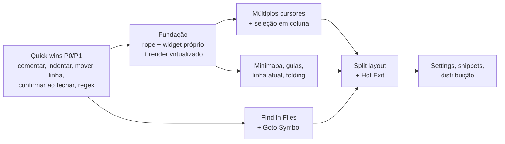

# Psychic Text Editor — TODO / Roadmap

Lista de funcionalidades do [Sublime Text](https://www.sublimetext.com/docs/) que ainda **não existem** no Psychic e que fazem sentido para o objetivo do projeto: um editor rápido, nativo, sem frescura, focado em arquivos de configuração e projetos pequenos.

> **Legenda de prioridade**
> - 🔴 **P0** — Essencial / bloqueia outras features
> - 🟠 **P1** — Alto impacto no dia a dia
> - 🟡 **P2** — Desejável
> - ⚪ **P3** — Nice to have / longo prazo
>
> **Esforço:** `S` (horas) · `M` (1–2 dias) · `L` (vários dias) · `XL` (semanas)

---

## ✅ Já implementado (referência)

Para evitar retrabalho, o que já existe hoje:

- Abas com indicador de alteração (`•`), fechar com botão do meio, rolagem lateral pela rodinha
- Sidebar com árvore de arquivos e toggle de dotfiles
- Command Palette (`Ctrl+Shift+P`), Goto Anything (`Ctrl+P` com `arquivo:linha`), Goto Line (`Ctrl+G`)
- Busca e substituição simples (`Ctrl+F` / `Ctrl+H`) com case-sensitive
- Syntax highlighting nativo (lexer próprio, zero-regex) para ~15 linguagens
- 5 temas de cor, zoom de fonte, word wrap, LF/CRLF
- Duplicar linha (`Ctrl+Shift+D`), Revert File, Close Other/All Tabs
- Sessão persistente por projeto (abas, linha/coluna, tema, fonte)
- JetBrains Mono Nerd Font embutida

---

## 🏗️ 0. Fundação técnica (pré-requisito de várias features)

> [!IMPORTANT]
> A fundação técnica com a **Opção A (Widget próprio no `egui` + `ropey`)** foi implementada na branch `feat/custom-editor-widget` e mergeada na `main`. Veja a especificação em [docs/EDITOR_WIDGET.md](EDITOR_WIDGET.md).

- [x] 🔴 **Widget de editor próprio** (`CodeView`) — `XL` (Implementado)
  - Desbloqueou múltiplos cursores, minimapa, guias de indentação, highlight da linha atual.
- [x] 🔴 **Buffer em Rope** (`ropey`) — `L` (Implementado)
  - Edições e conversões linha↔caractere em `O(log n)`.
- [x] 🔴 **Renderização virtualizada (só linhas visíveis)** — `L` (Implementado)
  - `CodeView` desenha somente `first_line..=last_line` com ring-cache de Galley por linha.
- [x] 🟠 **Histórico de Undo/Redo próprio** — `M` (Implementado)
  - Coalescing de digitação em 600ms e structural sharing O(1).

---

## ✏️ 1. Edição

### Múltiplas seleções (feature-assinatura do Sublime)
- [ ] 🟠 `Ctrl+D` — selecionar palavra e adicionar próxima ocorrência — `L` *(depende de 0)*
- [ ] 🟠 `Ctrl+K, Ctrl+D` — pular ocorrência atual
- [ ] 🟠 `Alt+F3` — selecionar todas as ocorrências
- [ ] 🟠 `Ctrl+Shift+L` — dividir seleção em um cursor por linha
- [ ] 🟠 `Ctrl+Clique` — adicionar cursor com o mouse
- [ ] 🟠 `Esc` — voltar para cursor único

### Seleção em coluna (box selection)
- [ ] 🟡 `Shift+Botão direito` arrastando / `Botão do meio` arrastando — `M` *(depende de 0)*
- [ ] 🟡 `Ctrl+Alt+↑/↓` — adicionar cursor na linha acima/abaixo

### Manipulação de linhas
- [ ] 🟠 `Ctrl+Shift+↑/↓` — mover linha(s) para cima/baixo — `S`
- [ ] 🟠 `Ctrl+Shift+K` — apagar linha — `S`
- [ ] 🟠 `Ctrl+Enter` / `Ctrl+Shift+Enter` — inserir linha abaixo/acima — `S`
- [ ] 🟠 `Ctrl+J` — juntar linhas (join lines) — `S`
- [ ] 🟡 `Ctrl+L` — expandir seleção para a linha — `S`
- [ ] 🟡 `Ctrl+Shift+M` — expandir seleção até os colchetes — `M`
- [ ] 🟡 `Ctrl+Shift+Space` — expandir seleção por escopo — `M`
- [ ] 🟡 `F9` — ordenar linhas (Sort Lines, case-sensitive opcional) — `S`
- [ ] ⚪ Remover linhas duplicadas (Permute Lines → Unique) — `S`
- [ ] ⚪ Reverter / embaralhar linhas — `S`

### Comentários e indentação
- [ ] 🔴 `Ctrl+/` — alternar comentário de linha (por linguagem: `//`, `#`, `;`, `--`) — `S`
- [ ] 🟠 `Ctrl+Shift+/` — alternar comentário de bloco (`/* */`, `<!-- -->`) — `S`
- [ ] 🔴 `Ctrl+]` / `Ctrl+[` e `Tab`/`Shift+Tab` em seleção — indentar/desindentar bloco — `S`
- [ ] 🔴 **Auto-indentação** ao pressionar `Enter` (mantém nível + indenta após `{`, `:`, etc.) — `M`
- [ ] 🟠 **Auto-fechamento de pares** `()`, `[]`, `{}`, `""`, `''` — `M`
- [ ] 🟡 Envolver seleção com par ao digitar `(`, `"`, etc. — `S`

### Transformação de texto
- [ ] 🟡 `Ctrl+K, Ctrl+U` / `Ctrl+K, Ctrl+L` — MAIÚSCULAS / minúsculas — `S`
- [ ] ⚪ Title Case, swap case — `S`
- [ ] ⚪ `Ctrl+T` — transpor caracteres — `S`

### Outros
- [ ] 🟡 **Snippets** com tab stops (`$1`, `${1:placeholder}`, `$0`) — `L`
- [ ] 🟡 **Autocomplete** baseado em palavras do buffer atual — `M`
- [ ] ⚪ Macros: gravar/reproduzir (`Ctrl+Q` / `Ctrl+Shift+Q`) — `L`
- [ ] ⚪ Paste and Indent (`Ctrl+Shift+V`) — `S`
- [ ] ⚪ Histórico de clipboard (`Ctrl+K, Ctrl+V`) — `M`

---

## 🔍 2. Busca

- [ ] 🔴 **Regex** na busca/substituição (toggle `.*` / `Alt+R`, capture groups `$1`) — `M`
  - Usar crate `regex` (sem backtracking, rápido).
- [ ] 🟠 **Whole word** (toggle `Alt+W`) — `S`
- [ ] 🟠 **Busca incremental** (`Ctrl+I`) — destaca enquanto digita — `M`
- [ ] 🟠 **Destacar todas as ocorrências** no editor + contador `3 de 17` — `M`
- [ ] 🟠 `F3` / `Shift+F3` — próxima/anterior ocorrência — `S`
- [ ] 🟠 **Replace (um por vez)** além do Replace All (`Ctrl+Shift+H`) — `S`
- [ ] 🟠 Corrigir **Replace All** para respeitar o toggle case-insensitive (hoje sempre case-sensitive) — `S`
- [ ] 🟡 **In selection** — buscar só dentro da seleção — `S`
- [ ] 🟡 `Ctrl+E` — usar seleção como termo de busca — `S`
- [ ] 🟡 Histórico de buscas anteriores (↑/↓ no campo) — `S`
- [ ] 🟠 **Find in Files** (`Ctrl+Shift+F`) — `L`
  - Filtros `*.rs, -target/`, regex, resultados navegáveis (duplo clique abre arquivo na linha).
  - Executar em thread separada para não travar a UI.
- [ ] 🟡 Replace in Files — `M`

---

## 🧭 3. Navegação

- [ ] 🟠 **Goto Symbol** (`Ctrl+R`) — funções, structs, classes, seções `[toml]` do arquivo atual — `M`
  - Pode reaproveitar o lexer atual para extrair símbolos.
- [ ] 🟡 Goto Anything com `@` (`Ctrl+P` → `main.rs@fn_name`) e `#` (busca de termo) — `S` *(depende de Goto Symbol)*
- [ ] ⚪ Goto Symbol in Project (`Ctrl+Shift+R`) — `L`
- [ ] 🟠 **Histórico de navegação** `Alt+-` / `Alt+Shift+-` (Jump Back / Forward) — `M`
- [ ] 🟡 **Bracket matching** — destacar par e `Ctrl+M` para pular até ele — `M`
- [ ] 🟡 **Bookmarks** — `Ctrl+F2` alternar, `F2`/`Shift+F2` navegar — `M`
- [ ] 🟠 `Ctrl+Tab` / `Ctrl+PageUp/PageDown` — alternar entre abas — `S`
- [ ] 🟠 `Alt+1..9` — ir direto para a aba N — `S`
- [ ] 🟡 `Ctrl+Shift+T` — reabrir última aba fechada — `S`
- [ ] 🟡 Navegação por palavra com `Ctrl+←/→` respeitando `snake_case`/`camelCase` (`Alt+←/→` sub-word) — `S`

---

## 🖥️ 4. Interface e Visualização

- [x] 🟠 **Minimapa** lateral clicável — `L` (Implementado no `CodeView`)
- [x] 🟠 **Highlight da linha atual** no editor — `S` (Implementado no `CodeView`)
- [x] 🟠 **Guias de indentação** verticais — `M` (Implementado no `CodeView`)
- [ ] 🟠 **Visualizador de Markdown Nativo (Split Preview / Toggle Preview)** — `M`
  - Renderização rica nativa no `egui` (sem WebKit/navegador embutido, zero C dependencies).
  - Suporte a cabeçalhos H1–H6, formatações (negrito, itálico, tachado), listas, tabelas, quotes, separadores horizontais, links clicáveis.
  - Blocos de código com syntax highlight integrado ao lexer do Psychic.
  - Split View lado a lado (`Ctrl+Shift+M`) com atualização em tempo real ao digitar.
- [ ] 🟡 **Code folding** (dobrar por indentação/chaves) — `L` *(depende de 0)*
- [ ] 🟡 **Exibir espaços em branco** (`draw_white_space`) e espaços no fim da linha — `S`
- [ ] 🟡 **Régua(s) vertical(is)** em colunas configuráveis (ex.: 80, 100) — `S`
- [ ] 🟠 **Split layout** — 2 colunas, 2 linhas, grade 2×2 (`Alt+Shift+1..5`) — `L`
  - Mover arquivo entre grupos (`Ctrl+Shift+1..4`), mesmo arquivo em dois painéis.
- [ ] 🟡 **Distraction Free Mode** (`Shift+F11`) — sem sidebar, abas e status bar — `S`
- [ ] 🟡 **Tela cheia** (`F11`) — `S`
- [ ] 🟡 Toggle **status bar** e **barra de abas** — `S`
- [ ] 🟡 **Preview de arquivo** ao clicar uma vez na sidebar (aba em itálico, substituída pelo próximo preview) — `M`
- [ ] ⚪ Tab Multi-Select (`Ctrl+Clique` em abas → abre em split) — `M`
- [ ] ⚪ Arrastar abas para reordenar — `M`
- [ ] 🟡 Menu de contexto (botão direito) no editor, abas e sidebar — `M`
- [ ] 🟡 Mais temas (Mariana fiel, Breakers, Celeste) + **tema de UI claro** (hoje só a sintaxe muda) — `M`
- [ ] ⚪ Seguir tema claro/escuro do GNOME automaticamente — `S`

---

## 📁 5. Arquivos e Sidebar

- [ ] 🔴 **Confirmação ao fechar aba/app com alterações não salvas** — `S`
  - Hoje fechar aba com `•` descarta as alterações sem perguntar.
- [ ] 🟠 **Hot Exit** — fechar sem perguntar e restaurar inclusive buffers não salvos e `untitled` — `M`
  - Estender o `ProjectSessionState` para salvar o conteúdo de buffers sujos.
- [ ] 🟠 **Detectar alteração externa** no disco e recarregar automaticamente (se não houver edição local) — `M`
  - Crate `notify` para file watching.
- [ ] 🟠 **Detecção de indentação** (tabs vs. espaços, tamanho) ao abrir arquivo + indicador na status bar — `S`
- [ ] 🟠 **Converter indentação** (Tabs ↔ Espaços) via Command Palette — `S`
- [ ] 🟡 **Detecção de encoding** (UTF-16, Latin-1) + Reopen/Save with Encoding — `M`
  - Hoje arquivos não-UTF-8 falham ao abrir.
- [ ] 🟡 Recusar/avisar ao abrir **arquivos binários** ou muito grandes — `S`
- [ ] 🟡 **Trim trailing whitespace** e **garantir newline no final** ao salvar (configurável) — `S`
- [ ] 🟡 **Salvar com sudo** para arquivos em `/etc` (via `pkexec`) — `M`
  - Muito relevante para o caso de uso de editar configs do sistema.
- [ ] 🟡 Ações na sidebar: novo arquivo, nova pasta, renomear, excluir, revelar no gerenciador de arquivos — `M`
- [ ] 🟡 **Arquivos recentes** e **pastas recentes** (`File > Open Recent`) — `S`
- [ ] 🟡 Múltiplas pastas na sidebar (projeto com várias raízes) — `M`
- [ ] 🟡 `Save All` (`Ctrl+Alt+S`) — `S`
- [ ] ⚪ Respeitar `.gitignore` no Quick Open e Find in Files (crate `ignore`) — `S`
- [ ] ⚪ Ícones de status Git na sidebar (modificado, novo, ignorado) — `L`
- [ ] ⚪ Marcadores Git no gutter (linhas adicionadas/modificadas/removidas) — `L`
- [ ] ⚪ Diálogo nativo de abrir/salvar do GNOME (portal XDG via crate `rfd`) como alternativa ao prompt de caminho — `S`

---

## ⚙️ 6. Configuração

- [ ] 🟠 **Arquivo de configurações do usuário** (`~/.config/psychic-text-editor/settings.toml`) — `M`
  - `font_size`, `tab_size`, `translate_tabs_to_spaces`, `word_wrap`, `theme`, `rulers`, `trim_trailing_white_space_on_save`, etc.
  - Abrir via Command Palette (“Preferences: Settings”).
- [ ] 🟡 **Configurações por linguagem** (ex.: YAML com 2 espaços, Makefile com tabs) — `S`
- [ ] 🟡 **Key bindings customizáveis** (`keymap.toml`) — `M`
- [ ] 🟡 Escolha de fonte (qualquer fonte do sistema além da embutida) — `S`
- [ ] ⚪ Recarregar configurações ao salvar o arquivo de settings — `S`

---

## 🎨 7. Syntax Highlighting

- [ ] 🟡 Mais linguagens úteis para config: **Dockerfile, Makefile, Nginx, SQL, XML/plist, `.env`, `.gitignore`, Nix, CSV** — `M`
- [ ] 🟡 Comentários de bloco multi-linha e strings multi-linha corretos em todas as linguagens (raw strings Rust `r#"..."#`, docstrings Python `"""`) — `M`
- [ ] ⚪ Suporte opcional a gramáticas `.sublime-syntax` / tree-sitter **carregadas sob demanda** (sem voltar ao custo do syntect no hot path) — `XL`
- [ ] ⚪ Importar temas `.tmTheme` / `.sublime-color-scheme` — `M`

---

## 🛠️ 8. Build Systems e Ferramentas (longo prazo)

- [ ] ⚪ **Build systems** (`Ctrl+B`): rodar comando configurável (`cargo run`, `python $file`) com painel de saída — `L`
  - Conflita com `Ctrl+B` (toggle sidebar) — decidir atalho.
- [ ] ⚪ Parsing de erros da saída (`file:line:col`) com navegação `F4` / `Shift+F4` — `M`
- [ ] ⚪ Terminal integrado — `XL` *(avaliar se condiz com o “sem frescura”)*
- [ ] ⚪ Cliente LSP opcional (goto definition, diagnostics) — `XL` *(avaliar)*
- [ ] ⚪ Sistema de plugins — `XL` *(avaliar; provavelmente fora de escopo)*

---

## 📦 9. Distribuição

- [ ] 🟠 Arquivo `.desktop` + ícone do app para aparecer no menu do GNOME — `S`
- [ ] 🟠 Associação de tipos MIME (abrir `.conf`, `.toml`, `.rs` etc. pelo Nautilus) — `S`
- [ ] 🟡 Comando `psychic` no `PATH` (`cargo install --path .`) e suporte a `psychic arquivo:linha` — `S`
- [ ] 🟡 **Instância única**: abrir arquivo pelo terminal em uma janela já aberta — `M`
- [ ] 🟡 Pacotes: AUR (`PKGBUILD`), Flatpak, AppImage, `.deb` — `M`
- [ ] ⚪ CI (GitHub Actions) rodando `cargo test`, `clippy` e `fmt` — `S`

---

## 🐛 Débitos técnicos identificados

- [ ] `find_next_in_active_tab` faz `to_lowercase()` do arquivo inteiro e `chars().count()` por ocorrência → `O(n²)` em arquivos grandes.
- [ ] `replace_all_in_active_tab` ignora o toggle case-insensitive.
- [ ] Salvar sessão a cada mudança de linha do cursor faz escrita em disco frequente → aplicar *debounce* (ex.: 1–2 s).
- [ ] `WorkspaceTree::collect_files` é síncrono e limitado a 2500 arquivos / profundidade 6 → indexar em background.
- [ ] Mensagens da UI misturam inglês e português → padronizar (ou adicionar i18n).
- [ ] `Ctrl+B` hoje é sidebar; no Sublime é Build (e sidebar é `Ctrl+K, Ctrl+B`) → definir política de atalhos (compatível com Sublime ou própria).

---

## 🎯 Sugestão de ordem de execução

1. **Quick wins** que funcionam com o `TextEdit` atual: comentar (`Ctrl+/`), indentar bloco, mover/apagar linha, confirmação de não-salvo, regex/whole word, alternar abas, `.desktop`.
2. **Fundação**: rope + widget de editor próprio + renderização virtualizada.
3. **Múltiplos cursores** (o grande diferencial do Sublime).
4. **Visual**: minimapa, guias de indentação, linha atual, bracket matching.
5. **Find in Files** e **Goto Symbol**.
6. **Split layout**, **Hot Exit**, file watching.
7. **Settings**, snippets, distribuição.
